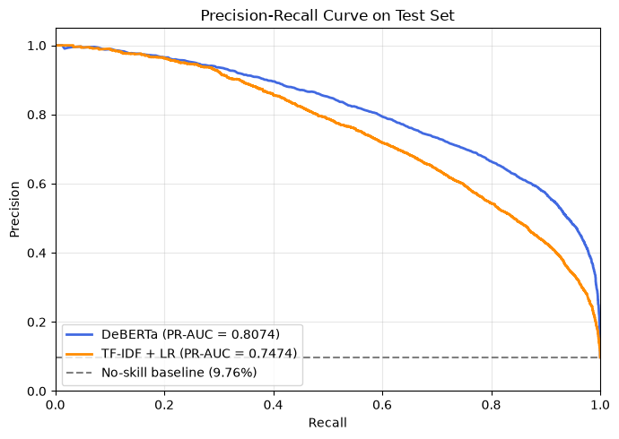

## Setup

### Import the dependencies


```python
import html
import json
import os
import re

import kagglehub
import kagglehub.auth
import matplotlib.pyplot as plt
import numpy as np
import pandas as pd
import torch
from datasets import Dataset
from IPython.display import display
from sklearn.dummy import DummyClassifier
from sklearn.feature_extraction.text import TfidfVectorizer
from sklearn.linear_model import LogisticRegression
from sklearn.metrics import (accuracy_score, average_precision_score, f1_score,
                             precision_recall_curve, precision_score,
                             recall_score)
from sklearn.model_selection import train_test_split
from sklearn.pipeline import Pipeline
from transformers import (AutoModelForSequenceClassification, AutoTokenizer,
                          DataCollatorWithPadding, Trainer, TrainingArguments)
```

### Global flags/configs


```python
# force save the dataframe after cleaning
FORCE_SAVE_DF = True

# force save the dataframe as csv
FORCE_SAVE_DF_CSV = True

# running locally
LOCAL_RUN = False

# force save the fine-tuned model after training
FORCE_SAVE_MODEL = True

# force save the predictions
FORCE_SAVE_PREDICTIONS = True

RANDOM_SEED = 13
```

### Determine the device to run the model on


```python
# os.environ["CUDA_VISIBLE_DEVICES"] = "1"
os.environ.setdefault("CUDA_VISIBLE_DEVICES", "1")

is_cuda = torch.cuda.is_available()
is_mps = torch.backends.mps.is_available()

if is_cuda:
    DEVICE = torch.device("cuda")
elif is_mps:
    DEVICE = torch.device("mps")
else:
    DEVICE = torch.device("cpu")

print(f"Using device: {DEVICE}")
```

    Using device: cuda


### Download the lexicon

The swear word lexicon is downloaded from [noswearing.com](https://www.noswearing.com/fulldict.xml).

```shell
curl -s https://www.noswearing.com/fulldict.xml -o data/lexicon/noswearing_raw.xml
```

### Process and clean the lexicon

The lexicon downloaded is in XML format. The words are extracted and saved in a separate text file.

Note that the lexicon contains some words that aren't swear words. These words are manually removed from the final lexicon.


```python
lexicon_directory = "./data/lexicon"
lexicon_raw_filepath = f"{lexicon_directory}/noswearing_raw.xml"
lexicon_filepath = f"{lexicon_directory}/noswearing.txt"

# extract words from the raw lexicon
with open(lexicon_raw_filepath, "r", encoding="utf-8") as f:
    words = re.findall(r"<title>(.*?)</title>", f.read())

# remove duplicates and sort
unique_words = sorted({word.strip().lower() for word in words})

whitelist = [
    # sexual orientation
    "gay",
    "lesbian",
    "queer",

    # sexual parts
    "anus",
    "penis",
    "testicle",
    "vagina",

    # other
    r"mothafuckin\\\'"
]

# remove whitelisted words
lexicon_filtered = [word for word in unique_words if word not in whitelist]

# save the lexicon
os.makedirs(lexicon_directory, exist_ok=True)

with open(lexicon_filepath, "w", encoding="utf-8") as f:
    f.write("\n".join(lexicon_filtered) + "\n")

print(
    f"Lexicon saved to {lexicon_filepath} with {len(lexicon_filtered)} words"
)
```

    Lexicon saved to ./data/lexicon/noswearing.txt with 341 words


### Download the dataset

Try to use the `kagglehub` library to download the dataset. If it fails, use the dataset in local directory.

More information about the dataset can be found [here](https://www.kaggle.com/competitions/jigsaw-toxic-comment-classification-challenge/).


```python
dataset_directory = "./data/dataset_raw"

try:
    if kagglehub.auth.get_kaggle_credentials() is not None:
        dataset_directory = kagglehub.competition_download(
            "jigsaw-toxic-comment-classification-challenge")
except Exception as e:
    print(e)

print("Path to dataset files:", dataset_directory)
```

    Path to dataset files: ./data/dataset_raw


### Load the dataset

Load the dataset into dataframes.

The dataset consists of 3 files:
- `train.csv.zip` - training data
- `test.csv.zip` - test data
- `test_labels.csv.zip` - test labels

The shapes and samples of each file are printed below.


```python
train_data_path = os.path.join(dataset_directory, "train.csv.zip")
train_data = pd.read_csv(train_data_path)

test_data_path = os.path.join(dataset_directory, "test.csv.zip")
test_data = pd.read_csv(test_data_path)

test_labels_path = os.path.join(dataset_directory, "test_labels.csv.zip")
test_labels = pd.read_csv(test_labels_path)

for name, df in [("TRAIN DATA", train_data), ("TEST DATA", test_data), ("TEST LABELS", test_labels)]:
    print(f"{"#" * 10} {name} {"#" * 10}")
    print(f"Shape: {df.shape}\n")
    df.info()
    print(f"\nSample data:\n{df.sample(5)}")
    print("\n" + "-" * 50 + "\n")
```

    ########## TRAIN DATA ##########
    Shape: (159571, 8)
    
    <class 'pandas.DataFrame'>
    RangeIndex: 159571 entries, 0 to 159570
    Data columns (total 8 columns):
     #   Column         Non-Null Count   Dtype
    ---  ------         --------------   -----
     0   id             159571 non-null  str  
     1   comment_text   159571 non-null  str  
     2   toxic          159571 non-null  int64
     3   severe_toxic   159571 non-null  int64
     4   obscene        159571 non-null  int64
     5   threat         159571 non-null  int64
     6   insult         159571 non-null  int64
     7   identity_hate  159571 non-null  int64
    dtypes: int64(6), str(2)
    memory usage: 72.2 MB
    
    Sample data:
                          id                                       comment_text  \
    92460   f73996cf48d948a0  "\n\nSpeedy deletion of Philvidler666\n A tag ...   
    21671   391cfa41e4f10852  "\n\nFirst of all the albanian migration in th...   
    157810  e3a58c2375eae8fa  " I suspect Jehochman has a WP:COI here in tha...   
    101543  1f73989aee291e63  "\nI'll give you my decision in one week. At t...   
    101752  20816cc5ec4b8785  You're welcome to keep playing in the WP:Sandb...   
    
            toxic  severe_toxic  obscene  threat  insult  identity_hate  
    92460       0             0        0       0       0              0  
    21671       0             0        0       0       0              0  
    157810      0             0        0       0       0              0  
    101543      0             0        0       0       0              0  
    101752      0             0        0       0       0              0  
    
    --------------------------------------------------
    
    ########## TEST DATA ##########
    Shape: (153164, 2)
    
    <class 'pandas.DataFrame'>
    RangeIndex: 153164 entries, 0 to 153163
    Data columns (total 2 columns):
     #   Column        Non-Null Count   Dtype
    ---  ------        --------------   -----
     0   id            153164 non-null  str  
     1   comment_text  153164 non-null  str  
    dtypes: str(2)
    memory usage: 58.6 MB
    
    Sample data:
                          id                                       comment_text
    33246   3747cec99526d0cf  there are no female voices...  just Adam Horovitz
    41919   4589808e2f648832  " \n :I've removed the conjecture from List of...
    106558  b1d8cf6c0a3f4b11  == Hawkins  == \n\n I've read through Bundy's ...
    121724  cb4a7bf44d435986  == WHAT == \n\n WHAT THE HECK DID YOU JUST SAY...
    62866   68b1e51ffd4022ee  " \n\n  Please do not vandalize pages, as you ...
    
    --------------------------------------------------
    
    ########## TEST LABELS ##########
    Shape: (153164, 7)
    
    <class 'pandas.DataFrame'>
    RangeIndex: 153164 entries, 0 to 153163
    Data columns (total 7 columns):
     #   Column         Non-Null Count   Dtype
    ---  ------         --------------   -----
     0   id             153164 non-null  str  
     1   toxic          153164 non-null  int64
     2   severe_toxic   153164 non-null  int64
     3   obscene        153164 non-null  int64
     4   threat         153164 non-null  int64
     5   insult         153164 non-null  int64
     6   identity_hate  153164 non-null  int64
    dtypes: int64(6), str(1)
    memory usage: 10.5 MB
    
    Sample data:
                         id  toxic  severe_toxic  obscene  threat  insult  \
    68779  727b38b831aad8de      0             0        0       0       0   
    3808   068a7d9959d84360     -1            -1       -1      -1      -1   
    18103  1e75388cbb12e07a      0             0        0       0       0   
    38276  3f8760d122917ee9      0             0        0       0       0   
    86692  90a97a8adfdf09dc     -1            -1       -1      -1      -1   
    
           identity_hate  
    68779              0  
    3808              -1  
    18103              0  
    38276              0  
    86692             -1  
    
    --------------------------------------------------
    


## Preprocessing

### Merge the toxic labels into one

The dataset consists of multiple toxic labels. But for this project, we are only considering if the comment is toxic or not. Thus, a new class `is_toxic` is created by checking if any of the toxic labels is 1.


```python
# get the toxic labels from the train data
toxic_labels = train_data.columns.tolist()
toxic_labels.remove("id")
toxic_labels.remove("comment_text")
print(f"Toxic labels: {toxic_labels}\n")


def create_is_toxic_column(df):
    new_df = df.copy()

    new_df["is_toxic"] = (
        new_df[toxic_labels] == 1
    ).any(axis=1).astype(int)

    return new_df


# create a new column to indicate if the comment is toxic
train_df = create_is_toxic_column(train_data)

# drop all the toxic labels columns
train_df = train_df.drop(columns=toxic_labels)

print(f"Sample train data:\n{train_df.sample(5)}\n")

for is_toxic, count in train_df["is_toxic"].value_counts().items():
    print(
        f"Number of {"toxic" if is_toxic == 1 else "non-toxic"} comments: {count:,d} ({count/len(train_df):.2%})"
    )
```

    Toxic labels: ['toxic', 'severe_toxic', 'obscene', 'threat', 'insult', 'identity_hate']
    
    Sample train data:
                          id                                       comment_text  \
    117620  7464422ef97038d0  "\nIn response to the army declaring them legi...   
    118853  7b3ea9c39c2f72d3  seems to be a sock created for the sole purpos...   
    92334   f6e031beb5d989f8  Moscow the death is coming, a plague on Ivan t...   
    59982   a08d8603405be6da  "\nInfobox\nI am trying to make the infoboxes ...   
    113605  5f79c5d5ccc3db8d  " \n\nI have twice requested moderation in an ...   
    
            is_toxic  
    117620         0  
    118853         0  
    92334          1  
    59982          0  
    113605         0  
    
    Number of non-toxic comments: 143,346 (89.83%)
    Number of toxic comments: 16,225 (10.17%)


### Clean up the test labels

In the test labels, there are comments that aren't labelled. These comments have a value of -1 for all the toxic labels. These comments are removed from the test labels.

After which, the same merging of toxic labels is applied. Then, these changes are being reflected on the test dataset.


```python
# remove the comments that have no labels
test_labels_clean = test_labels[
    (test_labels[toxic_labels] != -1)
    .all(axis=1)
]

# create a new column to indicate if the comment is toxic
test_labels_df = create_is_toxic_column(test_labels_clean)

# drop all the toxic classes columns
test_labels_df = test_labels_df.drop(columns=toxic_labels)

print(f"Test labels (filtered) shape: {test_labels_df.shape}\n")
print(f"Sample test labels (filtered):\n{test_labels_df.sample(5)}")

print("\n", "-"*50, "\n")

# merge the test data with the test labels
test_df = pd.merge(test_data, test_labels_df, on="id")

print(f"Test data (filtered) shape: {test_df.shape}\n")
print(f"Sample test data (filtered):\n{test_df.sample(5)}\n")

for is_toxic, count in test_df["is_toxic"].value_counts().items():
    print(
        f"Number of {"toxic" if is_toxic == 1 else "non-toxic"} comments: {count:,d} ({count/len(test_df):.2%})"
    )

# print(test_df['is_toxic'].value_counts(), "\n")
# print(
    # f"Toxic comments percentage: {test_df['is_toxic'].value_counts(normalize=True)[1]:.2%}"
# )
```

    Test labels (filtered) shape: (63978, 2)
    
    Sample test labels (filtered):
                          id  is_toxic
    68188   7185cba5e1b23a8d         0
    134341  e089af19664d87b2         0
    119290  c72bebdfbf7813bb         0
    114196  be939dfcb98c3e6e         0
    150426  fb709604031e8806         0
    
     -------------------------------------------------- 
    
    Test data (filtered) shape: (63978, 3)
    
    Sample test data (filtered):
                         id                                       comment_text  \
    19862  4eff13d957a2bc10  Well, then HOW THE FUCK DO I GET PERMISSION KO...   
    7335   1d82aac0f61f4d1a  " \n Hello, and welcome to Wikipedia. We appre...   
    48743  c226d74070c67242  " \n :::It appears Tanthalas39 has put an end ...   
    36980  93ad01191ae35072  What a bloody stupid thing to put at the start...   
    27783  6eba75d8fd6a3c8a  : That looks like sloppy work on my part. I th...   
    
           is_toxic  
    19862         1  
    7335          0  
    48743         0  
    36980         0  
    27783         0  
    
    Number of non-toxic comments: 57,735 (90.24%)
    Number of toxic comments: 6,243 (9.76%)


### Initial thoughts

- The dataset is extremely imbalanced, with only 10% of the comments being toxic. This will be a challenge when making a fair evaluation.
- There is no validation dataset, therefore we will have to split the training dataset into training and validation datasets.

### Basic check on data quality


```python
def check_data_quality(df):
    print(f"Total rows: {len(df)}\n")
    print(f"Missing values:\n{df.isna().sum()}\n")
    print(f"Duplicates: {df.duplicated().sum()}")
    print(
        f"Empty comments: {(df['comment_text'].fillna("").str.strip() == "").sum()}\n"
    )
    print(
        f"Sample texts:\n{json.dumps(df['comment_text'].sample(5).tolist(), indent=2, ensure_ascii=False)}"
    )


for name, df in [("train", train_df), ("test", test_df)]:
    print("#" * 10, f"Quality check for {name} data:", "#" * 10)
    check_data_quality(df)
    print("\n", "-"*50, "\n")
```

    ########## Quality check for train data: ##########
    Total rows: 159571
    
    Missing values:
    id              0
    comment_text    0
    is_toxic        0
    dtype: int64
    
    Duplicates: 0
    Empty comments: 0
    
    Sample texts:
    [
      "(other than Akamatsu's 'functional approach')",
      "So unlike the fifty cents the tooth fairy left under your pillow, you have no proof whatsoever about your fairy tale?",
      "And just a moment ago, Cooksi took off my Db-nn tag.",
      "—Preceding unsigned comment added by 71.235.80.60",
      "hi \n\nHi Help me with something and I'll tell you what if you write me something\nlevente 2- -2 november"
    ]
    
     -------------------------------------------------- 
    
    ########## Quality check for test data: ##########
    Total rows: 63978
    
    Missing values:
    id              0
    comment_text    0
    is_toxic        0
    dtype: int64
    
    Duplicates: 0
    Empty comments: 0
    
    Sample texts:
    [
      "\" \n\n Please do not add nonsense to Wikipedia. It is considered vandalism. If you would like to experiment, use the sandbox. Thank you.    |  | @) \"",
      "- May 13, 2008",
      "Thank you for the compliment. That page has to be one of the most shameful things I've seen in my time in Wikipedia.",
      "::Thanks Andrew. That's what I thought too. I couldn't find any useful information on this TRAC and there are some incorrect claims also on the site (which I'm sure to be incorrect).",
      "as being 'aggressive progressive'"
    ]
    
     -------------------------------------------------- 
    


#### Check for elongated words


```python
def has_repeated_chars(text):
    return bool(re.search(r"(.)\1{2,}", text))


for name, df in [("TRAIN DATA", train_df), ("TEST DATA", test_df)]:
    repeated_count = df["comment_text"].apply(has_repeated_chars).sum()
    print(
        f"{name} comments with repeated characters (>=3): {repeated_count:,d} ({repeated_count / len(df):.2%})"
    )
```

    TRAIN DATA comments with repeated characters (>=3): 42,345 (26.54%)
    TEST DATA comments with repeated characters (>=3): 25,814 (40.35%)


### Clean the data


```python
def clean_data(text):
    if pd.isna(text):
        return ""

    # unescape html entities
    text = html.unescape(text)

    # csv quotes
    text = text.replace('""', '"')

    # replace urls with token
    text = re.sub(r"https?://\S+|www\.\S+", "[URL]", text)

    # replace ips with token
    text = re.sub(r"\d{1,3}\.\d{1,3}\.\d{1,3}\.\d{1,3}", "[IP]", text)

    # remove wiki headers formatting
    text = re.sub(r"={2,}", "", text)

    # remove wiki indentation formatting
    text = re.sub(r"^\s*:+\s*", "", text, flags=re.MULTILINE)

    # collapse elongated words (from 3 to 2)
    text = re.sub(r"(.)\1{2,}", r"\1\1", text)

    # collapse horizontal spacings
    text = re.sub(r"[ \t]+", " ", text)

    # collapse vertical spacings
    text = re.sub(r"[\n\r]+", "\n", text)

    # remove whitespace
    text = text.strip()

    if (text.startswith('"') and text.endswith('"')) or (text.startswith("'") and text.endswith("'")):
        text = text[1:-1].strip()

    return text


demo_cases = [
    {
        "Rule Tested": "Wiki headers, indentation, URL, IP, HTML entity, word elongation",
        "Before": "== Admin Notice ==\n::: Visit https://en.wikipedia.org or contact 192.168.1.1 immediately! That was sooooo cool &amp; awesome.",
    },
    {
        "Rule Tested": "CSV escaped quotes, www URL, character elongation, trailing spaces",
        "Before": '""Hey you,"" check www.example.com/rules right nowwwwww!!!!!   ',
    }
]

demo_df = pd.DataFrame([
    {
        "Rule Tested": case["Rule Tested"],
        "Before": case["Before"],
        "After": clean_data(case["Before"])
    }
    for case in demo_cases
])

with pd.option_context("display.max_colwidth", None):
    display(demo_df)

for name, df in [("Train data", train_df), ("Test data", test_df)]:
    df["comment_text"] = df["comment_text"].apply(clean_data)
    print(
        f"{name} sample texts:\n{json.dumps(df['comment_text'].sample(5).tolist(), indent=2, ensure_ascii=False)}"
    )
    print("\n", "-"*50, "\n")
```


<div>
<style scoped>
    .dataframe tbody tr th:only-of-type {
        vertical-align: middle;
    }

    .dataframe tbody tr th {
        vertical-align: top;
    }

    .dataframe thead th {
        text-align: right;
    }
</style>
<table border="1" class="dataframe">
  <thead>
    <tr style="text-align: right;">
      <th></th>
      <th>Rule Tested</th>
      <th>Before</th>
      <th>After</th>
    </tr>
  </thead>
  <tbody>
    <tr>
      <th>0</th>
      <td>Wiki headers, indentation, URL, IP, HTML entity, word elongation</td>
      <td>== Admin Notice ==\n::: Visit https://en.wikipedia.org or contact 192.168.1.1 immediately! That was sooooo cool &amp;amp; awesome.</td>
      <td>Admin Notice \nVisit [URL] or contact [IP] immediately! That was soo cool &amp; awesome.</td>
    </tr>
    <tr>
      <th>1</th>
      <td>CSV escaped quotes, www URL, character elongation, trailing spaces</td>
      <td>""Hey you,"" check www.example.com/rules right nowwwwww!!!!!</td>
      <td>"Hey you," check [URL] right noww!!</td>
    </tr>
  </tbody>
</table>
</div>


    Train data sample texts:
    [
      "Comment Even wimbledon.org uses \"Henman Hill\" more, 157 pages are indexed by Google vs. around 80 for \"Aorangi Terrace\" or \"Aorangi Picnic Terrace\". Only about 20 pages use variations of \"Aorangi Terrace\" without saying \"Henman Hill\". One All England Club leaflet calls Henman Hill the \"Water Gardens\", others use \"Aorangi Terrace\" for the nearby paved refreshment area.",
      "Thanks for experimenting with the page Jodie Sweetin on Wikipedia. Your test worked, and has been reverted or removed. Please use the sandbox for any other tests you want to do. Take a look at the welcome page if you would like to learn more about contributing to our encyclopedia. Thanks. (talk)",
      "Blazon in question \nFrom the french translation it would be appear there is a small error with the image of the arms for Alloue. The blazon reads:\n\"De sable à deux chevrons d'or, accompagnés en chef de deux macles d'or, rempli d'azur.\"\nFrom this \"de deux macles d'or\" it seems that the lozenges should be or, not azure, and the fimbriated edge should be azure. I used the Chrome translator for english but, I am still not sure.",
      "PeeJay is correct, also the article mentions this twice in the abstract, which is redundant. Request that someone removes on. First paragraph: \"..becoming the first player to win four Ballons d'Or, all of which he won consecutively.\" Second paragraph: \"Messi is the first football player in history to win four FIFA/Ballons d'Or, all of which he won consecutively\" darksaber14",
      "After reading the article and comparing it to the content at [URL] it is obvious that much of the text has been copied from this site and only slightly modified. Frankly, most of this article is a thinly disguised promotional effort effort by the owner of the web site, National Starch LLC, to promote their corn product which they claim contains \"resistant starch\". The enourmous number of external links at the bottom of this article are also replicated on the same web site owned by this company and appear to be an attempt stack search engines when searching for \"resistant starch\"[IP]"
    ]
    
     -------------------------------------------------- 
    
    Test data sample texts:
    [
      "Chastain, any chef will tell you that you can't unfry the egg. I think Chillum is suggesting you turn down the flame so as not to burn yourself. Its good advice. Like you say, \"They do it repeatedly\". I have found that letting time pass is the best solution. .",
      "@#$%ing breeders going after my talk page again. -",
      "WikiProject British and Irish hills |class=start",
      "hey kersey! wut r u up 2?? whatever. gosh.. \n 1. black girls can!! \n 2. icy burnage.. \n 3. im sick on icebreakers.. \n 4. haley bug!! \n 5. billy rox P \n 6. youth dates.. wait. no that was haley.. nevermind. \n 7. myspace and AIM!! \n 8. El Zippidee!! \n 9. oh snap!! there HE is!! D \n 10. hot emo skater dude @ longhorns & ruby tuesdays!! <3 \n 11. PHIL WICKHAM=mylove",
      "Expanding and citations required \n This article has less number of citations kindly provide proper citations and try to improve article according to Wikipedia policies and kindly, expand it and if you allow my self I can certainly help you in expanding it. Thanks."
    ]
    
     -------------------------------------------------- 
    


A new class `has_swear` is also created to determine if the comments contain any swear words from the lexicon.


```python
with open(lexicon_filepath, "r", encoding="utf-8") as f:
    swear_words = [line.strip() for line in f if line.strip()]

swear_words = "|".join(map(re.escape, swear_words))
swear_word_pattern = re.compile(rf'\b(?:{swear_words})\b', flags=re.IGNORECASE)

for name, df in [("Train data", train_df), ("Test data", test_df)]:
    df["has_swear"] = df["comment_text"].str.contains(
        swear_word_pattern,
        regex=True
    ).astype(int)

    count_swear = df["has_swear"].sum()
    percentage_swear = count_swear/len(df)
    print(
        f"{name} - Comments with swear words: {count_swear:,d} out of {len(df):,d} ({percentage_swear:.2%})"
    )
```

    Train data - Comments with swear words: 10,971 out of 159,571 (6.88%)
    Test data - Comments with swear words: 6,108 out of 63,978 (9.55%)


### Split the training data into train and validation datasets


```python
train_df_backup = train_df.copy()

train_df, valid_df = train_test_split(
    train_df_backup,
    test_size=0.2,
    shuffle=True,
    random_state=RANDOM_SEED,
    stratify=train_df_backup[["is_toxic", "has_swear"]],
)

print(f"Size of train set: {len(train_df):,d}")
print(f"Size of validation set: {len(valid_df):,d}")
```

    Size of train set: 127,656
    Size of validation set: 31,915


### Split the test dataset into 4 slices


```python
# create word count column
test_df["word_count"] = test_df["comment_text"].apply(lambda x: len(x.split()))

# remap binary values to labels
is_toxic = test_df["is_toxic"].map({1: "toxic", 0: "non_toxic"})
has_swear = test_df["has_swear"].map({1: "with_swear", 0: "without_swear"})

# create slice class
test_df["slice"] = is_toxic + "_" + has_swear

for name, count in test_df["slice"].value_counts().items():
    print(f"{name}: {count:,d} ({count / len(test_df):.2%})")
```

    non_toxic_without_swear: 54,861 (85.75%)
    toxic_with_swear: 3,234 (5.05%)
    toxic_without_swear: 3,009 (4.70%)
    non_toxic_with_swear: 2,874 (4.49%)


```python
os.makedirs("./data/dataset", exist_ok=True)
csv_files_exists = all(
    os.path.exists(f"./data/dataset/{s}_clean.csv")
    for s in ["train", "valid", "test"]
)

if not csv_files_exists or FORCE_SAVE_DF_CSV:
    train_df.to_csv("./data/dataset/train_clean.csv", index=False)
    valid_df.to_csv("./data/dataset/valid_clean.csv", index=False)
    test_df.to_csv("./data/dataset/test_clean.csv", index=False)
    print("Dataframes saved as csv")
else:
    print("Dataframes already saved as csv")
```

    Dataframes saved as csv


### Checkpoint for the dataframes

Saving the dataframes as parquet files to avoid reprocessing the data.


```python
os.makedirs("./data/dataframe", exist_ok=True)
df_files_exists = all(
    os.path.exists(f"./data/dataframe/{s}.parquet")
    for s in ["train", "valid", "test"]
)

if not df_files_exists or FORCE_SAVE_DF:
    train_df.to_parquet("./data/dataframe/train.parquet")
    valid_df.to_parquet("./data/dataframe/valid.parquet")
    test_df.to_parquet("./data/dataframe/test.parquet")
    print("Dataframes saved")
else:
    train_df = pd.read_parquet("./data/dataframe/train.parquet")
    valid_df = pd.read_parquet("./data/dataframe/valid.parquet")
    test_df = pd.read_parquet("./data/dataframe/test.parquet")
    print("Dataframes loaded")
```

    Dataframes saved


### Overview

Big picture metrics for all 3 datasets.


```python
for name, df in [("Train", train_df), ("Valid", valid_df), ("Test", test_df)]:
    print(f"{"#"*10} {name} Dataset (Total: {len(df):,d}) {"#"*10}\n")

    ct = pd.crosstab(
        df["is_toxic"],
        df["has_swear"],
        margins=True
    )

    ct.index = ["Non-toxic", "Toxic", "All"]
    ct.columns = ["No swear", "With swear", "All"]

    def format_ct(count):
        percentage = count/len(df)
        return f"{count:,d} ({percentage:.2%})"

    print(ct.map(format_ct), "\n")

    toxic_with_swear = ct.loc["Toxic", "With swear"] / ct.loc["Toxic", "All"]
    nontoxic_with_swear = ct.loc["Non-toxic", "With swear"] \
        / ct.loc["Non-toxic", "All"]

    print(f"{toxic_with_swear:.2%} of toxic comments contain swear words")
    print(f"{nontoxic_with_swear:.2%} of non-toxic comments contain swear words")

    print("\n", "-" * 50, "\n")
```

    ########## Train Dataset (Total: 127,656) ##########
    
                       No swear     With swear                All
    Non-toxic  112,764 (88.33%)  1,912 (1.50%)   114,676 (89.83%)
    Toxic         6,115 (4.79%)  6,865 (5.38%)    12,980 (10.17%)
    All        118,879 (93.12%)  8,777 (6.88%)  127,656 (100.00%) 
    
    52.89% of toxic comments contain swear words
    1.67% of non-toxic comments contain swear words
    
     -------------------------------------------------- 
    
    ########## Valid Dataset (Total: 31,915) ##########
    
                      No swear     With swear               All
    Non-toxic  28,192 (88.33%)    478 (1.50%)   28,670 (89.83%)
    Toxic        1,529 (4.79%)  1,716 (5.38%)    3,245 (10.17%)
    All        29,721 (93.13%)  2,194 (6.87%)  31,915 (100.00%) 
    
    52.88% of toxic comments contain swear words
    1.67% of non-toxic comments contain swear words
    
     -------------------------------------------------- 
    
    ########## Test Dataset (Total: 63,978) ##########
    
                      No swear     With swear               All
    Non-toxic  54,861 (85.75%)  2,874 (4.49%)   57,735 (90.24%)
    Toxic        3,009 (4.70%)  3,234 (5.05%)     6,243 (9.76%)
    All        57,870 (90.45%)  6,108 (9.55%)  63,978 (100.00%) 
    
    51.80% of toxic comments contain swear words
    4.98% of non-toxic comments contain swear words
    
     -------------------------------------------------- 
    


## Baselines

### Floor baselines


```python
# majority class baseline
majority_baseline = DummyClassifier(strategy="most_frequent")
majority_baseline.fit(train_df["comment_text"], train_df["is_toxic"])

# random baseline
random_baseline = DummyClassifier(strategy="stratified", random_state=RANDOM_SEED)
_ = random_baseline.fit(train_df["comment_text"], train_df["is_toxic"])
```

### Rule-based baseline

The rule-based baseline is based on the assumption that toxic comments contain swear words. Thus, if a comment contains any swear words, it is classified as toxic. This can be achieved by referencing the `has_swear` column which was created previously above.

### Traditional ML baseline (TF-IDF + Logistic Regression)


```python
tfidf_lr_baseline = Pipeline([
    ("tfidf", TfidfVectorizer(
        ngram_range=(1, 2),
        max_features=25000,
        min_df=3,
        sublinear_tf=True
    )),
    ("clf", LogisticRegression(
        class_weight="balanced",
        max_iter=1000,
        random_state=RANDOM_SEED))
])

_ = tfidf_lr_baseline.fit(train_df["comment_text"], train_df["is_toxic"])
```

### Evaluation helper method


```python
def evaluate_model(y_true, y_pred, y_proba=None, model_name="Model"):
    # overall metrics
    accuracy = accuracy_score(y_true, y_pred)
    precision = precision_score(y_true, y_pred, zero_division=0)
    recall = recall_score(y_true, y_pred, zero_division=0)
    f1 = f1_score(y_true, y_pred, zero_division=0)
    pr_auc = average_precision_score(
        y_true,
        y_proba
    ) if y_proba is not None else None

    def calculation_slice_metrics(slice_name, calculation_method):
        slice = test_df["slice"] == slice_name
        slice_pred = y_pred[slice]
        slice_true = y_true[slice]
        return calculation_method(
            slice_true,
            slice_pred,
            zero_division=0
        )

    def false_positive_rate(y_true, y_pred, zero_division=0):
        false_positive = ((y_true == 0) & (y_pred == 1)).sum()
        true_negative = ((y_true == 0) & (y_pred == 0)).sum()
        total_negatives = false_positive + true_negative

        if total_negatives == 0:
            return zero_division

        return false_positive / total_negatives

    # recall for toxic slices
    recall_toxic_with_swear = calculation_slice_metrics(
        "toxic_with_swear",
        recall_score
    )

    recall_toxic_without_swear = calculation_slice_metrics(
        "toxic_without_swear",
        recall_score
    )

    delta_recall = recall_toxic_with_swear - recall_toxic_without_swear

    # fpr for non-toxic slices
    fpr_non_toxic_with_swear = calculation_slice_metrics(
        "non_toxic_with_swear",
        false_positive_rate
    )
    fpr_non_toxic_without_swear = calculation_slice_metrics(
        "non_toxic_without_swear",
        false_positive_rate
    )

    delta_fpr = fpr_non_toxic_with_swear - fpr_non_toxic_without_swear

    return {
        "Model": model_name,
        "Accuracy": round(accuracy, 4),
        "Precision": round(precision, 4),
        "Recall": round(recall, 4),
        "F1": round(f1, 4),
        "PR-AUC": round(pr_auc, 4) if pr_auc is not None else "N/A",
        "Recall (toxic with swear)": round(recall_toxic_with_swear, 4),
        "Recall (toxic without swear)": round(recall_toxic_without_swear, 4),
        "Delta Recall": round(delta_recall, 4),
        "FPR (non-toxic with swear)": round(fpr_non_toxic_with_swear, 4),
        "FPR (non-toxic without swear)": round(fpr_non_toxic_without_swear, 4),
        "Delta FPR": round(delta_fpr, 4)
    }
```

### Run evaluation on baselines


```python
y_true = test_df["is_toxic"]
test_texts = test_df["comment_text"]

# majority baseline
y_pred_majority = majority_baseline.predict(test_texts)
y_proba_majority = majority_baseline.predict_proba(test_texts)[:, 1]
result_majority = evaluate_model(
    y_true, y_pred_majority, y_proba_majority, "Majority Baseline")

# random baseline
y_pred_random = random_baseline.predict(test_texts)
y_proba_random = random_baseline.predict_proba(test_texts)[:, 1]
result_random = evaluate_model(
    y_true, y_pred_random, y_proba_random, "Random Baseline")

# rule-based baseline
y_pred_rule = test_df["has_swear"]
result_rule = evaluate_model(y_true, y_pred_rule, None, "Rule-Based Baseline")

# TF-IDF + Logistic Regression
y_pred_tfidf_lr = tfidf_lr_baseline.predict(test_texts)
y_proba_tfidf_lr = tfidf_lr_baseline.predict_proba(test_texts)[:, 1]
result_tfidf_lr = evaluate_model(
    y_true, y_pred_tfidf_lr, y_proba_tfidf_lr, "TF-IDF + Logistic Regression")
```

## Pre-trained model

### Define the model


```python
MODEL_NAME = "microsoft/deberta-v3-small" if LOCAL_RUN else "microsoft/deberta-v3-base"
tokenizer = AutoTokenizer.from_pretrained(MODEL_NAME)

sample_text = "This is a great project, not toxic at all!"
tokens = tokenizer(sample_text)
decoded_tokens = tokenizer.convert_ids_to_tokens(tokens["input_ids"])

token_preview = pd.DataFrame({
    "Token": decoded_tokens,
    "Token ID": tokens["input_ids"]
})

print(f"Model: {MODEL_NAME}")

display(token_preview)
```

    Model: microsoft/deberta-v3-base


<div>
<style scoped>
    .dataframe tbody tr th:only-of-type {
        vertical-align: middle;
    }

    .dataframe tbody tr th {
        vertical-align: top;
    }

    .dataframe thead th {
        text-align: right;
    }
</style>
<table border="1" class="dataframe">
  <thead>
    <tr style="text-align: right;">
      <th></th>
      <th>Token</th>
      <th>Token ID</th>
    </tr>
  </thead>
  <tbody>
    <tr>
      <th>0</th>
      <td>[CLS]</td>
      <td>1</td>
    </tr>
    <tr>
      <th>1</th>
      <td>▁This</td>
      <td>329</td>
    </tr>
    <tr>
      <th>2</th>
      <td>▁is</td>
      <td>269</td>
    </tr>
    <tr>
      <th>3</th>
      <td>▁a</td>
      <td>266</td>
    </tr>
    <tr>
      <th>4</th>
      <td>▁great</td>
      <td>426</td>
    </tr>
    <tr>
      <th>5</th>
      <td>▁project</td>
      <td>663</td>
    </tr>
    <tr>
      <th>6</th>
      <td>,</td>
      <td>261</td>
    </tr>
    <tr>
      <th>7</th>
      <td>▁not</td>
      <td>298</td>
    </tr>
    <tr>
      <th>8</th>
      <td>▁toxic</td>
      <td>7290</td>
    </tr>
    <tr>
      <th>9</th>
      <td>▁at</td>
      <td>288</td>
    </tr>
    <tr>
      <th>10</th>
      <td>▁all</td>
      <td>305</td>
    </tr>
    <tr>
      <th>11</th>
      <td>!</td>
      <td>300</td>
    </tr>
    <tr>
      <th>12</th>
      <td>[SEP]</td>
      <td>2</td>
    </tr>
  </tbody>
</table>
</div>


### Find the token size


```python
sample_comments = train_df["comment_text"].sample(
    10000,
    random_state=RANDOM_SEED
).tolist()
token_output = tokenizer(sample_comments, truncation=False)

# count the number of tokens in each comment
token_length = pd.Series([len(tokens) for tokens in token_output["input_ids"]])

# calculate percentiles and the percentage that fit under 128
print("Percentiles:")
print(token_length.quantile([0.50, 0.75, 0.82, 0.95, 1.0]))
percentage_under_128 = (token_length <= 128).mean()
print(f"\nExact percentage <= 128 tokens: {percentage_under_128:.2%}")
```

    Percentiles:
    0.50      47.00
    0.75      95.00
    0.82     124.00
    0.95     280.05
    1.00    2174.00
    dtype: float64
    
    Exact percentage <= 128 tokens: 82.75%


### Tokenize the dataset


```python
train_dataset = Dataset.from_pandas(train_df)
valid_dataset = Dataset.from_pandas(valid_df)
test_dataset = Dataset.from_pandas(test_df)


def tokenize(batch):
    tokens = tokenizer(batch["comment_text"], truncation=True, max_length=128)
    tokens["labels"] = batch["is_toxic"]
    return tokens


train_dataset = train_dataset.map(tokenize, batched=True)
valid_dataset = valid_dataset.map(tokenize, batched=True)
test_dataset = test_dataset.map(tokenize, batched=True)

train_dataset = train_dataset.remove_columns(["id"])
valid_dataset = valid_dataset.remove_columns(["id"])
test_dataset = test_dataset.remove_columns(["id"])
```


    Map:   0%|          | 0/127656 [00:00<?, ? examples/s]


    Map:   0%|          | 0/31915 [00:00<?, ? examples/s]


    Map:   0%|          | 0/63978 [00:00<?, ? examples/s]


```python
if LOCAL_RUN:
    train_dataset = train_dataset.shuffle(seed=RANDOM_SEED).select(range(3000))
    valid_dataset = valid_dataset.shuffle(seed=RANDOM_SEED).select(range(800))
    test_dataset = test_dataset.shuffle(seed=RANDOM_SEED).select(range(1000))
    print("Local run")
else:
    print("Not local run")
```

    Not local run


```python
model = AutoModelForSequenceClassification.from_pretrained(
    MODEL_NAME,
    num_labels=2,
    torch_dtype=torch.float32
)
model.to(DEVICE)


def compute_metrics(eval_pred):
    logits, labels = eval_pred
    predictions = logits.argmax(axis=-1)
    return {
        "accuracy": round(accuracy_score(labels, predictions), 4),
        "precision": round(precision_score(labels, predictions, zero_division=0), 4),
        "recall": round(recall_score(labels, predictions, zero_division=0), 4),
        "f1": round(f1_score(labels, predictions, zero_division=0), 4),
    }


batch_size = 16 if is_cuda else 8
target_batch_size = 32

training_args = TrainingArguments(
    output_dir="./artifact/model",
    num_train_epochs=1 if LOCAL_RUN else 3,
    per_device_train_batch_size=batch_size,
    per_device_eval_batch_size=batch_size * 2,
    gradient_accumulation_steps=target_batch_size // batch_size,
    bf16=is_cuda,
    learning_rate=2e-5,
    logging_steps=50,
    disable_tqdm=False,
    eval_strategy="epoch",
    save_strategy="epoch",
    load_best_model_at_end=True,
    metric_for_best_model="f1",
    greater_is_better=True,
    save_total_limit=2
    # label_names=["is_toxic"],
    # remove_unused_columns=False
)

trainer = Trainer(
    model=model,
    args=training_args,
    train_dataset=train_dataset,
    eval_dataset=valid_dataset,
    processing_class=tokenizer,
    data_collator=DataCollatorWithPadding(tokenizer=tokenizer),
    compute_metrics=compute_metrics
)

model_directory = "./artifact/model/best"
os.makedirs(model_directory, exist_ok=True)

if FORCE_SAVE_MODEL:
    trainer.train()
    trainer.save_model(model_directory)
    print(f"Model saved to {model_directory}")

else:
    model = AutoModelForSequenceClassification.from_pretrained(model_directory)
    model.to(DEVICE)
    model.eval()
    trainer.model = model
    print(f"Model loaded from {model_directory}")
```

    [transformers] `torch_dtype` is deprecated! Use `dtype` instead!
    /srv/data/guswonju/lt2326-2026-machine-learning-project/.venv/lib64/python3.12/site-packages/torch/jit/_script.py:1491: FutureWarning: `torch.jit.script` is deprecated. Please switch to `torch.compile` or `torch.export`.
      warnings.warn(
    Warning: You are sending unauthenticated requests to the HF Hub. Please set a HF_TOKEN to enable higher rate limits and faster downloads.


    Loading weights:   0%|          | 0/198 [00:00<?, ?it/s]


    [transformers] DebertaV2ForSequenceClassification LOAD REPORT from: microsoft/deberta-v3-base
    Key                                     | Status     | 
    ----------------------------------------+------------+-
    lm_predictions.lm_head.LayerNorm.bias   | UNEXPECTED | 
    lm_predictions.lm_head.bias             | UNEXPECTED | 
    mask_predictions.LayerNorm.bias         | UNEXPECTED | 
    lm_predictions.lm_head.dense.bias       | UNEXPECTED | 
    lm_predictions.lm_head.dense.weight     | UNEXPECTED | 
    mask_predictions.LayerNorm.weight       | UNEXPECTED | 
    mask_predictions.dense.bias             | UNEXPECTED | 
    mask_predictions.dense.weight           | UNEXPECTED | 
    lm_predictions.lm_head.LayerNorm.weight | UNEXPECTED | 
    mask_predictions.classifier.weight      | UNEXPECTED | 
    mask_predictions.classifier.bias        | UNEXPECTED | 
    classifier.weight                       | MISSING    | 
    pooler.dense.bias                       | MISSING    | 
    classifier.bias                         | MISSING    | 
    pooler.dense.weight                     | MISSING    | 
    
    Notes:
    - UNEXPECTED:	can be ignored when loading from different task/architecture; not ok if you expect identical arch.
    - MISSING:	those params were newly initialized because missing from the checkpoint. Consider training on your downstream task.
    [transformers] The tokenizer has new PAD/BOS/EOS tokens that differ from the model config and generation config. The model config and generation config were aligned accordingly, being updated with the tokenizer's values. Updated tokens: {'eos_token_id': 2, 'bos_token_id': 1}.


    <div>

      <progress value='11970' max='11970' style='width:300px; height:20px; vertical-align: middle;'></progress>
      [11970/11970 27:26, Epoch 3/3]
    </div>
    <table border="1" class="dataframe">
  <thead>
 <tr style="text-align: left;">
      <th>Epoch</th>
      <th>Training Loss</th>
      <th>Validation Loss</th>
      <th>Accuracy</th>
      <th>Precision</th>
      <th>Recall</th>
      <th>F1</th>
    </tr>
  </thead>
  <tbody>
    <tr>
      <td>1</td>
      <td>0.175574</td>
      <td>0.087014</td>
      <td>0.969100</td>
      <td>0.835600</td>
      <td>0.866300</td>
      <td>0.850700</td>
    </tr>
    <tr>
      <td>2</td>
      <td>0.170542</td>
      <td>0.088814</td>
      <td>0.969600</td>
      <td>0.834500</td>
      <td>0.874900</td>
      <td>0.854200</td>
    </tr>
    <tr>
      <td>3</td>
      <td>0.068572</td>
      <td>0.111834</td>
      <td>0.969600</td>
      <td>0.836900</td>
      <td>0.871200</td>
      <td>0.853700</td>
    </tr>
  </tbody>
</table><p>


    Writing model shards:   0%|          | 0/1 [00:00<?, ?it/s]


    Writing model shards:   0%|          | 0/1 [00:00<?, ?it/s]


    Writing model shards:   0%|          | 0/1 [00:00<?, ?it/s]


    Writing model shards:   0%|          | 0/1 [00:00<?, ?it/s]


    Model saved to ./artifact/model/best


### Run the prediction


```python
os.makedirs("./artifact/logits", exist_ok=True)

logits_path = "./artifact/logits/deberta_test_logits.npy"

if FORCE_SAVE_PREDICTIONS:
    test_pred = trainer.predict(test_dataset)
    logits = test_pred.predictions

    np.save(logits_path, logits)
    print(f"saved predictions to {logits_path}")
else:
    print("loading saved predictions")
    logits = np.load(logits_path)


y_pred_deberta = logits.argmax(axis=-1)
y_proba_deberta = torch.softmax(torch.tensor(logits), dim=-1)[:, 1].numpy()

result_deberta = evaluate_model(
    y_true,
    y_pred_deberta,
    y_proba_deberta,
    model_name="DeBERTa"
)
```


    saved predictions to ./artifact/logits/deberta_test_logits.npy


## Evaluation results


```python
test_results = pd.DataFrame([
    result_majority, result_random, result_rule, result_tfidf_lr, result_deberta
])

display(test_results)
```


<div>
<style scoped>
    .dataframe tbody tr th:only-of-type {
        vertical-align: middle;
    }

    .dataframe tbody tr th {
        vertical-align: top;
    }

    .dataframe thead th {
        text-align: right;
    }
</style>
<table border="1" class="dataframe">
  <thead>
    <tr style="text-align: right;">
      <th></th>
      <th>Model</th>
      <th>Accuracy</th>
      <th>Precision</th>
      <th>Recall</th>
      <th>F1</th>
      <th>PR-AUC</th>
      <th>Recall (toxic with swear)</th>
      <th>Recall (toxic without swear)</th>
      <th>Delta Recall</th>
      <th>FPR (non-toxic with swear)</th>
      <th>FPR (non-toxic without swear)</th>
      <th>Delta FPR</th>
    </tr>
  </thead>
  <tbody>
    <tr>
      <th>0</th>
      <td>Majority Baseline</td>
      <td>0.9024</td>
      <td>0.0000</td>
      <td>0.0000</td>
      <td>0.0000</td>
      <td>0.0976</td>
      <td>0.0000</td>
      <td>0.0000</td>
      <td>0.0000</td>
      <td>0.0000</td>
      <td>0.0000</td>
      <td>0.0000</td>
    </tr>
    <tr>
      <th>1</th>
      <td>Random Baseline</td>
      <td>0.8219</td>
      <td>0.1000</td>
      <td>0.1032</td>
      <td>0.1016</td>
      <td>0.0978</td>
      <td>0.1030</td>
      <td>0.1034</td>
      <td>-0.0004</td>
      <td>0.1023</td>
      <td>0.1003</td>
      <td>0.0020</td>
    </tr>
    <tr>
      <th>2</th>
      <td>Rule-Based Baseline</td>
      <td>0.9080</td>
      <td>0.5295</td>
      <td>0.5180</td>
      <td>0.5237</td>
      <td>N/A</td>
      <td>1.0000</td>
      <td>0.0000</td>
      <td>1.0000</td>
      <td>1.0000</td>
      <td>0.0000</td>
      <td>1.0000</td>
    </tr>
    <tr>
      <th>3</th>
      <td>TF-IDF + Logistic Regression</td>
      <td>0.8722</td>
      <td>0.4267</td>
      <td>0.9020</td>
      <td>0.5793</td>
      <td>0.7474</td>
      <td>0.9536</td>
      <td>0.8465</td>
      <td>0.1072</td>
      <td>0.6500</td>
      <td>0.1039</td>
      <td>0.5461</td>
    </tr>
    <tr>
      <th>4</th>
      <td>DeBERTa</td>
      <td>0.9051</td>
      <td>0.5074</td>
      <td>0.9369</td>
      <td>0.6583</td>
      <td>0.8074</td>
      <td>0.9706</td>
      <td>0.9006</td>
      <td>0.0700</td>
      <td>0.5828</td>
      <td>0.0730</td>
      <td>0.5098</td>
    </tr>
  </tbody>
</table>
</div>


```python
overall_columns = [
    "Model", "Accuracy", "Precision", "Recall", "F1", "PR-AUC"
]

print(
    test_results[overall_columns].to_latex(
        index=False,
        float_format="%.4f",
        caption="Overall test set performance across baselines and DeBERTa.",
        label="tab:overall_results"
    )
)
```

    \begin{table}
    \caption{Overall test set performance across baselines and DeBERTa.}
    \label{tab:overall_results}
    \begin{tabular}{lrrrrl}
    \toprule
    Model & Accuracy & Precision & Recall & F1 & PR-AUC \\
    \midrule
    Majority Baseline & 0.9024 & 0.0000 & 0.0000 & 0.0000 & 0.0976 \\
    Random Baseline & 0.8219 & 0.1000 & 0.1032 & 0.1016 & 0.0978 \\
    Rule-Based Baseline & 0.9080 & 0.5295 & 0.5180 & 0.5237 & N/A \\
    TF-IDF + Logistic Regression & 0.8722 & 0.4267 & 0.9020 & 0.5793 & 0.7474 \\
    DeBERTa & 0.9051 & 0.5074 & 0.9369 & 0.6583 & 0.8074 \\
    \bottomrule
    \end{tabular}
    \end{table}
    


```python
slice_cols = [
    "Model",
    "Recall (toxic with swear)",
    "Recall (toxic without swear)",
    "Delta Recall",
    "FPR (non-toxic with swear)",
    "FPR (non-toxic without swear)",
    "Delta FPR"
]
print(
    test_results[slice_cols].to_latex(
        index=False,
        float_format="%.4f",
        caption="Slice-based recall and false positive rates.",
        label="tab:slice_results"
    )
)
```

    \begin{table}
    \caption{Slice-based recall and false positive rates.}
    \label{tab:slice_results}
    \begin{tabular}{lrrrrrr}
    \toprule
    Model & Recall (toxic with swear) & Recall (toxic without swear) & Delta Recall & FPR (non-toxic with swear) & FPR (non-toxic without swear) & Delta FPR \\
    \midrule
    Majority Baseline & 0.0000 & 0.0000 & 0.0000 & 0.0000 & 0.0000 & 0.0000 \\
    Random Baseline & 0.1030 & 0.1034 & -0.0004 & 0.1023 & 0.1003 & 0.0020 \\
    Rule-Based Baseline & 1.0000 & 0.0000 & 1.0000 & 1.0000 & 0.0000 & 1.0000 \\
    TF-IDF + Logistic Regression & 0.9536 & 0.8465 & 0.1072 & 0.6500 & 0.1039 & 0.5461 \\
    DeBERTa & 0.9706 & 0.9006 & 0.0700 & 0.5828 & 0.0730 & 0.5098 \\
    \bottomrule
    \end{tabular}
    \end{table}
    


### Precision-Recall Curve


```python
# calculate precision and recall points for DeBERTa
deberta_precision, deberta_recall, _ = precision_recall_curve(
    y_true, y_proba_deberta
)

# calculate precision and recall points for TF-IDF + Logistic Regression
tfidf_lr_precision, tfidf_lr_recall, _ = precision_recall_curve(
    y_true, y_proba_tfidf_lr
)

# create the plot canvas
plt.figure(figsize=(7, 5))

# plot the DeBERTa curve
plt.plot(
    deberta_recall,
    deberta_precision,
    label=f"DeBERTa (PR-AUC = {result_deberta['PR-AUC']:.4f})",
    color="royalblue",
    linewidth=2
)

# plot the TF-IDF + Logistic Regression curve
plt.plot(
    tfidf_lr_recall,
    tfidf_lr_precision,
    label=f"TF-IDF + LR (PR-AUC = {result_tfidf_lr['PR-AUC']:.4f})",
    color="darkorange",
    linewidth=2
)

# plot the baseline reference (the overall percentage of toxic comments)
toxic_prevalence = y_true.mean()
plt.axhline(
    y=toxic_prevalence,
    color="gray",
    linestyle="--",
    label=f"No-skill baseline ({toxic_prevalence:.2%})"
)

# labels, titles, and legend
plt.xlabel("Recall")
plt.ylabel("Precision")
plt.title("Precision-Recall Curve on Test Set")
plt.xlim(0.0, 1.0)
plt.ylim(0.0, 1.05)
plt.grid(True, alpha=0.3)
plt.legend(loc="lower left")

os.makedirs("./artifact/figures", exist_ok=True)
plt.savefig("./artifact/figures/pr_auc_curve.pdf")

plt.tight_layout()
plt.show()
```


    

    


### Peek into TFIDF + Logistic Regression


```python
tfidf = tfidf_lr_baseline.named_steps["tfidf"]
logistic_regression = tfidf_lr_baseline.named_steps["clf"]

# get features and their coefficients
feature_names = tfidf.get_feature_names_out()
coefficients = logistic_regression.coef_[0]

features_coefficients_df = pd.DataFrame({
    "feature": feature_names,
    "coefficient": coefficients
})

top_toxic_words = features_coefficients_df.sort_values(
    by="coefficient",
    ascending=False
).head(10)
print("Top 10 words predicting TOXIC:")
display(top_toxic_words)

top_non_toxic_words = features_coefficients_df.sort_values(
    by="coefficient",
    ascending=True
).head(10)
print("Top 10 words predicting NON-TOXIC:")
display(top_non_toxic_words)
```

    Top 10 words predicting TOXIC:


<div>
<style scoped>
    .dataframe tbody tr th:only-of-type {
        vertical-align: middle;
    }

    .dataframe tbody tr th {
        vertical-align: top;
    }

    .dataframe thead th {
        text-align: right;
    }
</style>
<table border="1" class="dataframe">
  <thead>
    <tr style="text-align: right;">
      <th></th>
      <th>feature</th>
      <th>coefficient</th>
    </tr>
  </thead>
  <tbody>
    <tr>
      <th>8075</th>
      <td>fuck</td>
      <td>22.703788</td>
    </tr>
    <tr>
      <th>8091</th>
      <td>fucking</td>
      <td>19.752164</td>
    </tr>
    <tr>
      <th>18874</th>
      <td>stupid</td>
      <td>18.670918</td>
    </tr>
    <tr>
      <th>17883</th>
      <td>shit</td>
      <td>18.027719</td>
    </tr>
    <tr>
      <th>9540</th>
      <td>idiot</td>
      <td>15.857121</td>
    </tr>
    <tr>
      <th>2460</th>
      <td>ass</td>
      <td>14.264203</td>
    </tr>
    <tr>
      <th>5291</th>
      <td>crap</td>
      <td>12.673539</td>
    </tr>
    <tr>
      <th>3671</th>
      <td>bullshit</td>
      <td>11.785164</td>
    </tr>
    <tr>
      <th>18959</th>
      <td>suck</td>
      <td>11.554243</td>
    </tr>
    <tr>
      <th>2486</th>
      <td>asshole</td>
      <td>11.551425</td>
    </tr>
  </tbody>
</table>
</div>


    Top 10 words predicting NON-TOXIC:


<div>
<style scoped>
    .dataframe tbody tr th:only-of-type {
        vertical-align: middle;
    }

    .dataframe tbody tr th {
        vertical-align: top;
    }

    .dataframe thead th {
        text-align: right;
    }
</style>
<table border="1" class="dataframe">
  <thead>
    <tr style="text-align: right;">
      <th></th>
      <th>feature</th>
      <th>coefficient</th>
    </tr>
  </thead>
  <tbody>
    <tr>
      <th>19445</th>
      <td>thanks</td>
      <td>-5.881380</td>
    </tr>
    <tr>
      <th>19238</th>
      <td>talk</td>
      <td>-5.012646</td>
    </tr>
    <tr>
      <th>19443</th>
      <td>thank</td>
      <td>-4.814703</td>
    </tr>
    <tr>
      <th>19444</th>
      <td>thank you</td>
      <td>-4.790001</td>
    </tr>
    <tr>
      <th>15590</th>
      <td>please</td>
      <td>-4.741403</td>
    </tr>
    <tr>
      <th>9053</th>
      <td>help</td>
      <td>-3.681248</td>
    </tr>
    <tr>
      <th>3311</th>
      <td>best</td>
      <td>-3.530499</td>
    </tr>
    <tr>
      <th>24346</th>
      <td>wp</td>
      <td>-3.339651</td>
    </tr>
    <tr>
      <th>4323</th>
      <td>cheers</td>
      <td>-3.233703</td>
    </tr>
    <tr>
      <th>23354</th>
      <td>welcome</td>
      <td>-3.226656</td>
    </tr>
  </tbody>
</table>
</div>


### Compare TFIDF+LR and DeBERTa


```python
analysis_df = pd.DataFrame({
    "comment_text": test_df["comment_text"],
    "slice": test_df["slice"],
    "is_toxic": test_df["is_toxic"],
    "has_swear": test_df["has_swear"],
    "pred_tfidf_lr": y_pred_tfidf_lr,
    "prob_tfidf_lr": y_proba_tfidf_lr.round(4),
    "pred_deberta": y_pred_deberta,
    "prob_deberta": y_proba_deberta.round(4)
})


def print_samples(df, n=3):
    for _, row in df.sample(n).iterrows():
        print(f"\n[Comment]:\n{row['comment_text'][:200]}...")
        print(
            f"[TF-IDF+LR]: {row['pred_tfidf_lr']} (Prob: {row["prob_tfidf_lr"]:.4f})"
        )
        print(
            f"[DeBERTa]: {row['pred_deberta']} (Prob: {row["prob_deberta"]:.4f})"
        )


non_toxic_with_swear_slice = analysis_df[
    analysis_df["slice"] == "non_toxic_with_swear"
]
tfidf_lr_incorrect = (
    non_toxic_with_swear_slice["pred_tfidf_lr"] == 1
).sum()
deberta_incorrect = (non_toxic_with_swear_slice["pred_deberta"] == 1).sum()

print(
    f"Total non-toxic comments with swear words: {len(non_toxic_with_swear_slice):,d}"
)
print(f"\tFalse alarms by TF-IDF+LR: {tfidf_lr_incorrect:,d}")
print(f"\tFalse alarms by DeBERTa: {deberta_incorrect:,d}")

print("\n", "-"*100, "\n")

deberta_correct_tfidf_lr_incorrect = non_toxic_with_swear_slice[
    (non_toxic_with_swear_slice["pred_tfidf_lr"] == 1) &
    (non_toxic_with_swear_slice["pred_deberta"] == 0)
]

print(
    f"TF-IDF wrong, DeBERTa correct: {len(deberta_correct_tfidf_lr_incorrect):,d}"
)
print_samples(deberta_correct_tfidf_lr_incorrect)

print("\n", "-"*100, "\n")

deberta_incorrect_tfidf_lr_incorrect = non_toxic_with_swear_slice[
    (non_toxic_with_swear_slice["pred_tfidf_lr"] == 1) &
    (non_toxic_with_swear_slice["pred_deberta"] == 1)
]

print(
    f"Both TF-IDF and DeBERTa wrong: {len(deberta_incorrect_tfidf_lr_incorrect):,d}"
)
print_samples(deberta_incorrect_tfidf_lr_incorrect)
```

    Total non-toxic comments with swear words: 2,874
    	False alarms by TF-IDF+LR: 1,868
    	False alarms by DeBERTa: 1,675
    
     ---------------------------------------------------------------------------------------------------- 
    
    TF-IDF wrong, DeBERTa correct: 466
    
    [Comment]:
    cause I'm pretty pissed....
    [TF-IDF+LR]: 1 (Prob: 0.5226)
    [DeBERTa]: 0 (Prob: 0.4973)
    
    [Comment]:
    politics 
     Denethor is alot like george bush..because hes a complete dumass....
    [TF-IDF+LR]: 1 (Prob: 0.8011)
    [DeBERTa]: 0 (Prob: 0.0661)
    
    [Comment]:
    Well, a station that loses out on the CW (in a market with both WB and UPN) isn't going to close up shop.. they may be shit-out-of-luck, but they won't close, as too much money is at stake - they'll g...
    [TF-IDF+LR]: 1 (Prob: 0.5010)
    [DeBERTa]: 0 (Prob: 0.0376)
    
     ---------------------------------------------------------------------------------------------------- 
    
    Both TF-IDF and DeBERTa wrong: 1,402
    
    [Comment]:
    Yiffy Picture Artwork 
     The current picture under Erotic or pornographic art is what we call scat and waterplay (piss and shit). When I seen that I was frightened in my seat. 
     I don't think we (Furry...
    [TF-IDF+LR]: 1 (Prob: 0.8842)
    [DeBERTa]: 1 (Prob: 0.9124)
    
    [Comment]:
    Some more weird shit from my childhood....
    [TF-IDF+LR]: 1 (Prob: 0.9944)
    [DeBERTa]: 1 (Prob: 0.9853)
    
    [Comment]:
    What a WP:Dick, get some social skills ffs...
    [TF-IDF+LR]: 1 (Prob: 0.9734)
    [DeBERTa]: 1 (Prob: 0.9863)


```python
toxic_without_swear_slice = analysis_df[
    analysis_df["slice"] == "toxic_without_swear"
]
tfidf_lr_misses = (toxic_without_swear_slice["pred_tfidf_lr"] == 0).sum()
deberta_misses = (toxic_without_swear_slice["pred_deberta"] == 0).sum()

print(
    f"Total toxic comments without swear words: {len(toxic_without_swear_slice):,d}"
)
print(f"\tMissed by TF-IDF+LR: {tfidf_lr_misses:,d}")
print(f"\tMissed by DeBERTa: {deberta_misses:,d}")

print("\n", "-"*100, "\n")

deberta_catches_tfidf_lr_misses = toxic_without_swear_slice[
    (toxic_without_swear_slice["pred_tfidf_lr"] == 0) &
    (toxic_without_swear_slice["pred_deberta"] == 1)
]

print(
    f"TF-IDF misses, DeBERTa catches: {len(deberta_catches_tfidf_lr_misses):,d}"
)
print_samples(deberta_catches_tfidf_lr_misses)

print("\n", "-"*100, "\n")

deberta_misses_tfidf_lr_misses = toxic_without_swear_slice[
    (toxic_without_swear_slice["pred_tfidf_lr"] == 0) &
    (toxic_without_swear_slice["pred_deberta"] == 0)
]

print(
    f"Both TF-IDF and DeBERTa misses: {len(deberta_misses_tfidf_lr_misses):,d}"
)
print_samples(deberta_misses_tfidf_lr_misses)
```

    Total toxic comments without swear words: 3,009
    	Missed by TF-IDF+LR: 462
    	Missed by DeBERTa: 299
    
     ---------------------------------------------------------------------------------------------------- 
    
    TF-IDF misses, DeBERTa catches: 320
    
    [Comment]:
    Judensau (Germany) German for "Jewish swine" 
     *...
    [TF-IDF+LR]: 0 (Prob: 0.2389)
    [DeBERTa]: 1 (Prob: 0.8824)
    
    [Comment]:
    he was the gayest person alive....
    [TF-IDF+LR]: 0 (Prob: 0.3423)
    [DeBERTa]: 1 (Prob: 0.9707)
    
    [Comment]:
    Swaminarayan was a father of priyesh and has a poo face...
    [TF-IDF+LR]: 0 (Prob: 0.3156)
    [DeBERTa]: 1 (Prob: 0.8728)
    
     ---------------------------------------------------------------------------------------------------- 
    
    Both TF-IDF and DeBERTa misses: 142
    
    [Comment]:
    Hey thanks for your support . I remember skimming through and seeing that war, but I dared not getting involved with that.. I think it had something to do with those aweful historicist tables. Now tha...
    [TF-IDF+LR]: 0 (Prob: 0.4856)
    [DeBERTa]: 0 (Prob: 0.0176)
    
    [Comment]:
    Hillary Clinton Is Really A Lesibian!...
    [TF-IDF+LR]: 0 (Prob: 0.2590)
    [DeBERTa]: 0 (Prob: 0.0775)
    
    [Comment]:
    B l A k E .! Lovess Chriss Brownn . Soo , FCk ! Rihannaa .! She Desrevedd It >;(...
    [TF-IDF+LR]: 0 (Prob: 0.4868)
    [DeBERTa]: 0 (Prob: 0.0097)


#### Example 1


```python
false_alarm_sample_row = analysis_df.loc[262]
print(f"Comment:\n{false_alarm_sample_row['comment_text']}")
print(f"(is_toxic={false_alarm_sample_row['is_toxic']})")
print(f"(has_swear={false_alarm_sample_row['has_swear']})")
print(
    f"TF-IDF + LR prediction: {false_alarm_sample_row['pred_tfidf_lr']} ({false_alarm_sample_row["prob_tfidf_lr"]:.2%})")
print(
    f"DeBERTa prediction: {false_alarm_sample_row['pred_deberta']} ({false_alarm_sample_row["prob_deberta"]:.2%})")
```

    Comment:
    Well honestly I cant be fucking bothered tonight. So sleep wee all u editors ans admits . I'm off to bed. CU anaon
    (is_toxic=0)
    (has_swear=1)
    TF-IDF + LR prediction: 1 (99.43%)
    DeBERTa prediction: 1 (99.38%)


#### Example 2


```python
blind_spot_sample_row = analysis_df.loc[55642]
print(f"Comment:\n{blind_spot_sample_row['comment_text']}")
print(f"(is_toxic={blind_spot_sample_row['is_toxic']})")
print(f"(has_swear={blind_spot_sample_row['has_swear']})")
print(
    f"TF-IDF + LR prediction: {blind_spot_sample_row['pred_tfidf_lr']} ({blind_spot_sample_row["prob_tfidf_lr"]:.2%})")
print(
    f"DeBERTa prediction: {blind_spot_sample_row['pred_deberta']} ({blind_spot_sample_row["prob_deberta"]:.2%})")
```

    Comment:
    Nice job inserting your left-wing garbage in Jan Brewers article. I removed it and if you vandalize the article again you will be blocked from editing on Wikipedia.
    (is_toxic=1)
    (has_swear=0)
    TF-IDF + LR prediction: 0 (47.34%)
    DeBERTa prediction: 0 (9.74%)

